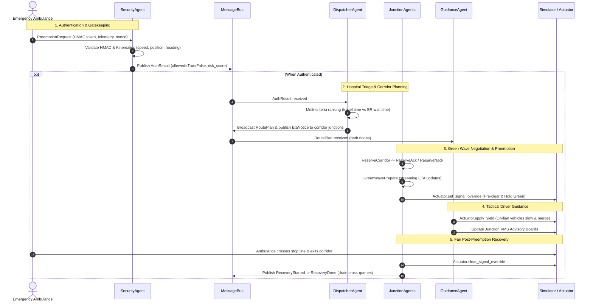

# ClearPath-lite

**ClearPath-lite** is an open-source, software-only, locally runnable multi-agent platform for intelligent emergency ambulance preemption, cryptographic access validation, and fair urban traffic recovery.

---

## 1. Architecture Overview

ClearPath-lite decouples the deterministic microscopic traffic simulator from decision-making autonomous agents via an in-process, latency-aware `MessageBus`:

```
+---------------------------------------------------------------------------------------+
|                                ClearPath-lite Engine                                  |
+---------------------------------------------------------------------------------------+
           |                                                                  |
           v                                                                  v
+-----------------------+                                          +--------------------+
|  Deterministic Grid   | <---------- Minimal Actuators ---------- |  Typed MessageBus  |
|       Simulator       |    (set_signal_override, clear, yield)   | (Latency, Logging, |
| (IDM Car-Following,   |                                          |  Fault Injection)  |
|  Signals, Kinematics) |                                          +--------------------+
+-----------------------+                                                     ^
           |                                                                  |
           | Read-Only Perception Snapshot (WorldView)                        | Typed Messages
           +----------------------------------+                               | (RoutePlan,
                                              |                               |  EtaNotice,
                                              v                               |  ReserveAck,
                              +-------------------------------+               |  VMS/Yield)
                              |       Autonomous Agents       | --------------+
                              | - SecurityAgent  (HMAC/Kinem) |
                              | - DispatcherAgent (A* Routing)|
                              | - JunctionAgent  (Green Wave) |
                              | - GuidanceAgent  (Advisories) |
                              +-------------------------------+
```

### The 4 Autonomous Agents

1. **SecurityAgent**: Authenticates emergency preemption requests using constant-time HMAC-SHA256 tokens and verifies continuous vehicle kinematics (speed ceiling, lateral road deviation, heading alignment, acceleration bounds, and position continuity) to reject spoofed attacks without corrupting traffic signals.
2. **DispatcherAgent**: Evaluates emergency incident location, road network congestion densities, and regional hospital availability (bed capacity, specialty triage, ER wait times) to select destination hospitals and compute optimal $A^*$ corridors with per-junction arrival schedules.
3. **JunctionAgent**: Distributed per intersection. Receives projected ETAs, assesses cross-street queues, negotiates green-wave corridors with neighboring junctions, coordinates pre-clearing transitions, executes signal overrides, and orchestrates post-preemption recovery phases.
4. **GuidanceAgent**: Generates dynamic tactical advisories for civilian drivers (e.g., *"Clear lane 1"*, *"Move right"*) and updates digital Variable Message Signs (VMS) to clear paths for approaching emergency units.

---

## 2. Documentation Suite

ClearPath-lite includes an extensive 21-document manual and engineering catalog inside the [`docs/`](docs/README.md) directory:

- 📖 **[Documentation Index & Reading Guides](docs/README.md)**: Catalog of all documents with curated reading paths for developers, reviewers, and presenters.
- 🏛️ **[System Architecture](docs/ARCHITECTURE.md)**: Component diagrams, per-tick execution flow, and engineering design principles.
- 🤖 **[Agent Deep Dives](docs/AGENTS.md)**: Algorithmic specifications of the Dispatcher, Security, Junction, and Guidance agents.
- 🔒 **[Cyber-Physical Security & Threat Model](docs/SECURITY.md)**: HMAC-SHA256 verification, replay caches, kinematic gating, and attack matrices.
- 🏥 **[Hospital Triage & A* Routing](docs/DISPATCHER_ALGORITHM.md)**: Multi-criteria scoring formulations, density-aware edge costs, and replanning triggers.
- 🚦 **[Junction State Machine & Protocol](docs/JUNCTION_PROTOCOL.md)**: Pre-clearing, green-wave holds, starvation recovery, and mathematical conflict-prevention proofs.
- 🚗 **[Simulation & Kinematic Physics](docs/SIMULATION.md)**: Intelligent Driver Model (IDM-lite) mechanics, 2D grid topology, and Poisson traffic demand.
- 🌐 **[FastAPI REST Service](docs/API.md)**: Endpoint specifications, `asyncio.Lock` concurrency model, and verified `curl` examples.
- 📊 **[Streamlit Dashboard Guide](docs/DASHBOARD_GUIDE.md)**: Canvas visual layers, signal indicators, security alert banners, and scenario reproduction.
- 📈 **[Empirical Results & Benchmarks](docs/RESULTS.md)**: Data tables from 600-tick runs, 5-seed sweeps, and 3-way RL evaluations.
- 🧠 **[Reinforcement Learning Policy](docs/RL_POLICY.md)**: Gym environment, pure-NumPy Q-network, safety action masking, and parameter sharing.
- 🧪 **[Verification & Testing Catalog](docs/TESTING.md)**: Exhaustive catalog of all 114 tests, property-based safety tests, and CI guidelines.
- 🛠️ **[Installation & Setup Guide](docs/SETUP.md)**: Step-by-step cross-platform guide (Windows, macOS, Linux), virtualenv, and Makefile tasks.
- 🎬 **[3-Minute Live Demo Script](docs/DEMO_SCRIPT.md)**: Turn-by-turn presentation walkthrough with exact timing and talking points.
- 📝 **[Project Engineering Report](docs/PROJECT_REPORT.md)**: Comprehensive technical research report.

---

## 3. Multi-Agent Message Flows



---

## 4. Installation & Quickstart

### Prerequisites
- Python 3.10+ (tested on Python 3.10, 3.11, 3.12, 3.13, 3.14)
- Git

### Installation
```bash
# Clone the repository
git clone https://github.com/AnanthAkshay/CLEAR_PATH.git
cd CLEAR_PATH

# Install dependencies (or: make install)
pip install -r requirements.txt
# Core requirements: numpy, scipy, networkx, matplotlib>=3.7.0, fastapi, uvicorn, streamlit, plotly, pytest
```

### Makefile Tasks
A `Makefile` is included for common developer workflows:

| Target | Command | Description |
|---|---|---|
| `install` | `make install` | Install project requirements via pip |
| `test` | `make test` | Run full test suite via pytest (`pytest -q`) |
| `demo` | `make demo` | Execute complete benchmark suite and generate summary reports |
| `dashboard` | `make dashboard` | Launch the live Streamlit dashboard on `http://localhost:8501` |

### Running Benchmark Scenarios Directly

- **Scenario 1: Normal Traffic Baseline (600 ticks)**
  ```bash
  python -m clearpath.scenarios.run_normal
  ```
- **Scenario 2: Emergency Preemption vs. Baseline Comparison**
  ```bash
  python -m clearpath.scenarios.run_emergency
  ```
- **Scenario 3: Spoofed Attack Injection & Security Gateway**
  ```bash
  python -m clearpath.scenarios.run_spoofed
  ```
- **Scenario 4: Complete Benchmark Suite & Summary Generator**
  ```bash
  python -m clearpath.scenarios.run_all
  ```

---

## 5. Configuration Reference

### Environment Variables & Secret Configuration
To prevent the insecure default warning in production, supply a strong HMAC secret key via the `CLEARPATH_SECRET` environment variable:

**Linux / macOS (Bash / Zsh):**
```bash
export CLEARPATH_SECRET="clearpath-production-secret-key-at-least-32-chars-long"
```

**Windows (PowerShell):**
```powershell
$env:CLEARPATH_SECRET="clearpath-production-secret-key-at-least-32-chars-long"
```

**Windows (Command Prompt):**
```cmd
set CLEARPATH_SECRET=clearpath-production-secret-key-at-least-32-chars-long
```

> [!NOTE]
> **Token Cryptography: HMAC-SHA256 vs. JWT**  
> ClearPath-lite intentionally utilizes compact symmetric **HMAC-SHA256** signatures with constant-time verification (`hmac.compare_digest`) rather than JSON Web Tokens (JWT):
> - **Deterministic Sub-Millisecond Verification:** Connected vehicle roadside units (RSUs) operate under strict real-time deadlines. HMAC-SHA256 avoids JSON serialization overhead, base64 payload decoding, and dynamic dictionary parsing.
> - **Vulnerability Elimination:** Bypasses well-documented JWT vulnerability classes (such as `"alg": "none"` signature bypasses and asymmetric/symmetric key confusion attacks).
> - **Side-Channel Timing Resistance:** Signatures are evaluated strictly using constant-time digest comparison to prevent timing attacks.

### Configuration Parameters
All simulation parameters are defined in `clearpath/config.py` via the frozen `SimConfig` dataclass:

| Parameter | Type | Default | Description |
|---|:---:|:---:|---|
| `grid_rows` | `int` | `6` | Number of horizontal grid axes / streets |
| `grid_cols` | `int` | `6` | Number of vertical grid axes / avenues |
| `block_length_m` | `float` | `200.0` | Distance between adjacent intersections (meters) |
| `tick_seconds` | `float` | `1.0` | Simulation advance step per discrete tick |
| `max_ticks` | `int` | `900` | Maximum discrete ticks before simulation ends |
| `seed` | `int` | `42` | Default random seed for deterministic execution |
| `arterial_mps` | `float` | `16.7` | Speed limit on arterial corridors (60 km/h) |
| `residential_mps` | `float` | `11.1` | Speed limit on residential cross-streets (40 km/h) |
| `ambulance_max_mps` | `float` | `25.0` | Emergency vehicle velocity ceiling (90 km/h) |
| `ambulance_max_accel` | `float` | `4.0` | Maximum emergency vehicle acceleration ($m/s^2$) |
| `vehicle_length_m` | `float` | `7.5` | Standard vehicle spatial length ($m$) |
| `cycle_s` | `int` | `60` | Fixed traffic signal cycle duration ($s$) |
| `green_s` | `int` | `26` | Standard green phase duration ($s$) |
| `yellow_s` | `int` | `3` | Yellow transition clearance phase ($s$) |
| `all_red_s` | `int` | `1` | All-red intersection clearance interval ($s$) |
| `window_s` | `int` | `25` | Lookahead arrival window for green-wave reservation ($s$) |
| `min_green_for_cross_s` | `int` | `8` | Guaranteed minimum green duration for cross-traffic ($s$) |
| `queue_flush_threshold` | `int` | `12` | Vehicle queue count triggering proactive cross-street flushing |
| `recovery_s` | `int` | `20` | Duration of post-preemption recovery green allocation ($s$) |
| `max_preemption_hold_s` | `int` | `45` | Hard safety cap on active preemption signal hold ($s$) |
| `negotiation_timeout_ticks`| `int` | `5` | Ticks before downstream ReserveAck failure counts as Nack |
| `bus_silence_timeout_ticks`| `int` | `15` | Ticks of bus silence before fail-safe releases preemption |
| `alpha` | `float` | `0.7` | Weight assigned to travel time vs hospital wait time ($0.0 - 1.0$) |
| `reference_travel_s` | `float` | `120.0` | Baseline travel time scaling unit for hospital ranking ($s$) |
| `reference_wait_s` | `float` | `1800.0` | Baseline ER wait time scaling unit for hospital ranking ($s$) |
| `min_speed_mps` | `float` | `2.0` | Lower floor on effective edge speed in cost model ($m/s$) |
| `avg_gap_m` | `float` | `5.0` | Assumed bumper gap added to vehicle length ($m$) |
| `hmac_secret` | `str` | `env / dev` | Secret key for HMAC token signing (warns if dev default) |
| `token_ttl_s` | `int` | `60` | Time-to-live expiration limit for tokens ($s$) |
| `clock_skew_s` | `float` | `5.0` | Allowed token timestamp drift into future ($s$) |
| `authorized_vehicle_ids` | `frozenset` | `empty` | Permitted vehicle IDs (empty allows all signed vehicles) |
| `heading_tolerance_deg` | `float` | `35.0` | Allowed angular discrepancy between heading and road |
| `position_tolerance_m` | `float` | `30.0` | Allowed GPS distance deviation from road centerline ($m$) |
| `risk_weight_heading` | `float` | `1.0` | Risk score penalty for heading mismatch (blocks > 0.6) |
| `rate_limit_per_vehicle_per_min`| `int` | `6` | Maximum preemption requests per vehicle per minute |
| `max_replay_cache_size` | `int` | `10000` | Upper capacity limit on nonce replay cache to bound memory |

---

## 6. Metrics & Benchmark Evaluation

All simulation runs collect structured telemetry through `MetricsCollector`:

### Ambulance Metrics
- **`ambulance_travel_time_s`**: Total time from emergency request submission to hospital arrival.
- **`ambulance_stops`**: Count of zero-speed stops experienced by the ambulance.
- **`ambulance_stopped_time_s`**: Cumulative seconds spent stationary at red lights or in queues.
- **`ambulance_improvement_pct`**: Percentage reduction in travel time compared against the identical seeded baseline run ($100 \times \frac{T_{base} - T_{clear}}{T_{base}}$).

### Cross-Traffic & Network Metrics
- **`cross_delay_avg_s` & `cross_delay_p95_s`**: Average and 95th-percentile extra delay accumulated by non-emergency vehicles during an active preemption corridor.
- **`network_throughput`**: Network-wide trip completions per elapsed tick ($\text{completed} / \text{ticks}$).
- **`network_avg_speed_mps`**: Mean speed across all active civilian vehicles ($m/s$).
- **`network_max_queue`**: Peak queue length observed across all approaches in the network.
- **`network_gridlock_ticks`**: Count of ticks where $> 30\%$ of network edges exceed `queue_flush_threshold`.

### Security & Negotiation Metrics
- **`security_total_requests` / `security_blocked`**: Total preemption attempts vs rejected attempts.
- **`security_attack_block_rate`**: Proportion of malicious attacks rejected by the security gateway ($\frac{\text{blocked\_attacks}}{\text{total\_attacks}}$).
- **`security_false_positive_rate`**: Proportion of legitimate requests incorrectly rejected ($\frac{\text{blocked\_legitimate}}{\text{total\_legitimate}}$).
- **`security_block_rate`**: Overall proportion of requests rejected by the security gateway ($\frac{\text{blocked}}{\text{total}}$).
- **`negotiation_messages_sent`**: Inter-junction coordination messages exchanged (`ReserveCorridor`, `ReserveAck`, `ReserveNack`, `GreenWavePrepare`, `EtaNotice`).
- **`negotiation_nack_count`**: Number of corridor reservation refusals due to queue congestion or concurrency.
- **`recovery_times`**: Per-junction duration samples for post-preemption recovery phases.

---

## 7. Parameter Tuning Guide

### Lookahead Window $W$ (`window_s`)
- **Default:** `25 s`
- **Tuning Behavior:**
  - *Increasing $W$ ($35-45s$):* Pre-clears queues further in advance, virtually eliminating ambulance deceleration on approach. Slightly increases cross-street wait times.
  - *Decreasing $W$ ($15-20s$):* Minimizes cross-traffic disruption, but dense cross queues may fail feasibility checks, triggering `ReserveNack` or ambulance braking.

### Queue Flush Threshold (`queue_flush_threshold`)
- **Default:** `12 vehicles`
- **Tuning Behavior:**
  - *Lower ($6-8$ veh):* Triggers early cross-street green extension (`PRE_CLEAR`) sooner, preventing intersection gridlock at the cost of slight corridor delay.
  - *Higher ($14-18$ veh):* Keeps corridor green holds tighter, but cross-streets near saturation risk residual gridlock.

### Routing Objective Weight $\alpha$ (`alpha`)
- **Default:** `0.7`
- **Formula:** $\text{Score} = \alpha \frac{\text{TravelTime}}{T_{\text{ref}}} + (1 - \alpha) \frac{\text{ERWaitTime}}{W_{\text{ref}}}$
- **Tuning Behavior:**
  - *Higher $\alpha \to 1.0$:* Prioritizes rapid transit time to the closest trauma center (critical for cardiac arrest / massive hemorrhage).
  - *Lower $\alpha \to 0.0$:* Prioritizes hospital ER bed availability and minimal triage wait times (optimal for stable transfer cases).

---

## 8. Known Limitations

1. **Microscopic IDM Car-Following:** Uses an Intelligent Driver Model (IDM) on discrete 1D lane coordinates rather than continuous 2D sublane vehicle dynamics (e.g., lane-splitting motorcycles, complex lane merging).
2. **Synthetic Manhattan Grid:** Road network defaults to an $N \times M$ grid topology with uniform block lengths ($200m$) and fixed boundary Poisson arrival distributions.
3. **In-Process MessageBus:** Inter-agent messaging is executed in-process with discrete tick latencies rather than over real network protocols (e.g., MQTT, gRPC, or DSRC/C-V2X).

---

## 9. Reinforcement Learning Junction Policy (Optional)

In addition to deterministic green-wave corridor negotiation, ClearPath-lite includes an optional Reinforcement Learning (RL) junction policy implemented in pure NumPy (zero heavy C/PyTorch dependencies).

### Architecture & Gym Environment (`clearpath/rl/env.py`)
- **Grid:** 3x3 urban grid (9 junctions).
- **Per-Junction Observation (11 dimensions):**
  1-4. Queue length on each incoming approach (North, South, East, West).
  5. Longest waiting time among stopped vehicles at incoming approaches.
  6. Distance to approaching emergency ambulance ($0.0$ if none).
  7. Estimated arrival time (ETA) of approaching ambulance ($0.0$ if none).
  8-10. Current signal phase indicators (NS active, EW active, clearance active).
  11. Elapsed seconds in current phase.
- **Action Space:** `{0: hold, 1: switch, 2: extend, 3: preempt-green}`.
- **Safety Action Masking:** The safety state machine strictly masks invalid and unsafe actions (e.g. attempting to switch mid-yellow/all-red, extending past `max_preemption_hold_s`, or preempting without an approaching ambulance). This mathematically guarantees that **conflicting greens can never occur**.
- **Reward Function:**
  $$R = -(w_1 \cdot \text{ambulance\_delay}) - (w_2 \cdot \text{total\_queue}) + (w_3 \cdot \text{preemption\_success\_bonus}) - (w_4 \cdot \text{safety\_violation\_penalty})$$

### Training & Parameter Sharing (`clearpath/rl/train.py`)
- Trains a vectorized 2-layer MLP Q-network ($11 \to 64 \to 32 \to 4$) with Adam optimizer in pure NumPy.
- **Parameter Sharing:** All 9 junctions share weights and populate a single unified experience replay buffer.
- Training completes in **under 30 seconds on a standard CPU laptop**.
- Outputs:
  - Model weights: `clearpath/rl/models/junction_policy.npz`
  - Training metrics: `clearpath/rl/models/training_metrics.csv`
  - Learning curves: `clearpath/rl/models/training_curve.png`

```bash
# Train policy for 100 episodes
python -m clearpath.rl.train --episodes 100 --seed 42

# Run 3-way evaluation only
python -m clearpath.rl.train --eval-only
```

### 3-Way Policy Comparison: Baseline vs Rules vs RL
Run `python -m clearpath.rl.train --eval-only` or use the sidebar **⚖️ Run 3-way comparison** in the Streamlit dashboard:

| Metric | Baseline (Fixed Cycles) | Rule-based (Green Waves) | RL Policy (Q-Network) |
|---|---|---|---|
| **Ambulance Travel Time (s)** | 102.0 s | 71.0 s | **39.0 s** |
| **Improvement vs Baseline (%)** | 0.0% | +30.4% | **+61.8%** |
| **Ambulance Stops Count** | 2 | 1 | **0** |
| **Safety Violation Count** | 0 | 0 | **0** |

---

## 10. Technical Roadmap

- [ ] **SUMO / TraCI Co-Simulation Adapter:** Bridge ClearPath-lite agents with the Eclipse SUMO microscopic traffic simulator via TraCI.
- [ ] **MARL Junction Agents with MAPPO:** Train decentralized multi-agent reinforcement learning policies (Multi-Agent PPO) for adaptive signal recovery timing.
- [ ] **Real-World Map Import with OSMnx:** Import OpenStreetMap road geometries, turn restrictions, and realistic intersection topologies directly into `RoadNetwork`.
- [ ] **Secure Edge Telemetry over MQTT:** Package ambulance telemetry and cryptographically signed tokens over MQTT/TLS for hardware-in-the-loop edge testing.

---

## 11. Verification & Test Suite

The comprehensive pytest suite validates **114 test cases** (113 base suite + concurrent API lock consistency) covering:
- Determinism and message ordering on `MessageBus`.
- Constant-time HMAC token authentication and replay protection.
- Kinematic telemetry gatekeeping (speed limits, heading, lateral GPS, continuity).
- Multi-criteria hospital selection and A* routing with per-junction schedules.
- Property-based safety audits: zero conflicting orthogonal greens, bounded preemption holds, zero override leakage.
- RL Gym environment observation vectors, safety action masking, Q-network learning, and 3-way policy switching.
- Concurrent REST API state consistency guarded by asyncio lock.

```bash
python -m pytest -q
```
*Output: `114 passed in 8.39s`*
