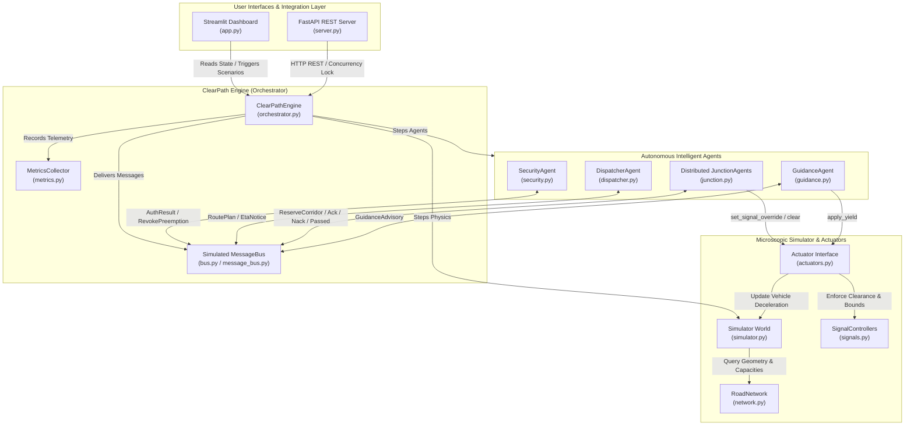
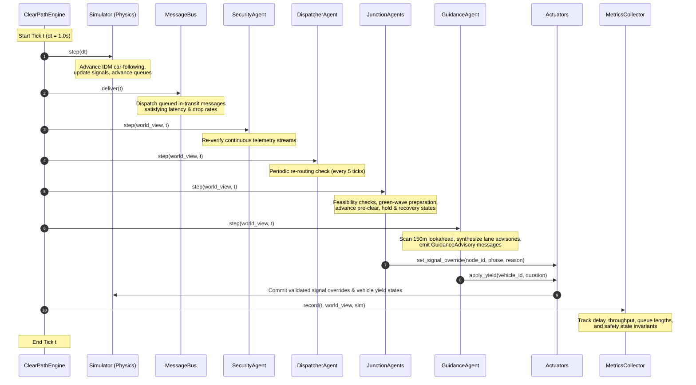

# ClearPath-lite System Architecture

ClearPath-lite is an event-driven, multi-agent cyber-physical platform designed for secure emergency vehicle preemption and equitable urban traffic management. It decouples high-level intelligent decision-making from low-level microscopic physics through an asynchronous, typed message bus.

## Table of Contents
- [1. System Overview](#1-system-overview)
- [2. Component Architecture](#2-component-architecture)
- [3. Per-Tick Simulation and Agent Flow](#3-per-tick-simulation-and-agent-flow)
- [4. Package and Module Organization](#4-package-and-module-organization)
- [5. Core Engineering Principles](#5-core-engineering-principles)
- [6. Cross-Document References](#6-cross-document-references)

---

## 1. System Overview

Urban emergency preemption systems face three fundamental challenges:
1. **Late Preemption:** Traditional line-of-sight optic sensors only detect approaching emergency vehicles within 50–100 meters, forcing emergency vehicles to brake while waiting for signals to cycle.
2. **Cross-Street Starvation & Gridlock:** Uncoordinated preemption locks signals green indefinitely, causing catastrophic queuing on intersecting corridors that takes hours to dissolve.
3. **Vulnerability to Cyber-Physical Attacks:** Legacy acoustic or optical sensors lack cryptographic authentication and can be spoofed using commodity transmitters.

ClearPath-lite resolves these challenges through a modular multi-agent architecture:
- **Asynchronous Separation:** Autonomous agents ([Dispatcher](AGENTS.md#1-dispatcheragent), [Security](AGENTS.md#2-securityagent), [Junctions](AGENTS.md#3-junctionagent), and [Guidance](AGENTS.md#4-guidanceagent)) communicate exclusively via typed messages over a simulated [MessageBus](MESSAGE_PROTOCOL.md), preventing agents from accessing simulator internals directly.
- **Fail-Safe Actuation:** Hardware-level signal controllers enforce mandatory physical yellow and all-red clearance intervals, ensuring that neither software bugs nor malicious messages can cause conflicting orthogonal greens.
- **Microscopic Physics:** A 2D road network simulator advances civilian and emergency vehicles using an Intelligent Driver Model (IDM-lite), enforcing collision-free vehicle following, red-light obedience, and realistic deceleration profiles.

---

## 2. Component Architecture

The diagram below illustrates the major subsystem boundaries, communication channels, and external interfaces of ClearPath-lite:



---

## 3. Per-Tick Simulation and Agent Flow

The discrete event engine runs in synchronous ticks (default $\Delta t = 1.0\text{ s}$). The execution order is deterministic and strictly sequenced:



---

## 4. Package and Module Organization

The ClearPath repository is structured into distinct, decoupled Python packages:

```
a:/CLEARPATH/
├── clearpath/
│   ├── config.py                 # Frozen SimConfig dataclass & parameter loading
│   ├── agents/                   # Autonomous intelligence layer
│   │   ├── base.py               # Abstract base Agent class
│   │   ├── dispatcher.py         # Hospital selection & A* corridor routing
│   │   ├── security.py           # HMAC token & kinematic telemetry validation
│   │   ├── junction.py           # Distributed junction coordination & state machine
│   │   ├── guidance.py           # VMS board & tactical vehicle lane guidance
│   │   └── tokens.py             # HMAC-SHA256 generation & constant-time verify
│   ├── bus/                      # Communication abstraction
│   │   ├── message_bus.py        # Asynchronous broadcast & unicast message bus
│   │   └── messages.py           # Typed dataclass messages
│   ├── engine/                   # Simulation lifecycle & integration
│   │   ├── orchestrator.py       # ClearPathEngine runtime loop
│   │   ├── actuators.py          # Guarded hardware signal & vehicle actuators
│   │   └── metrics.py            # Telemetry collection, snapshots & KPI math
│   ├── sim/                      # Microscopic traffic simulator
│   │   ├── network.py            # NetworkX road graph & hospital database
│   │   ├── simulator.py          # Microscopic step loop & collision detection
│   │   ├── vehicles.py           # IDM-lite car-following & kinematics
│   │   ├── signals.py            # Fixed-time controllers & clearance state machine
│   │   └── traffic_gen.py        # Deterministic Poisson perimeter arrival generator
│   ├── rl/                       # Reinforcement learning extension
│   │   ├── env.py                # Gym-style multi-junction environment with action masking
│   │   ├── train.py              # NumPy vectorized Q-learning with parameter sharing
│   │   └── models/               # Serialized weights (.npz) & training curves (.png)
│   ├── api/                      # External interface
│   │   └── server.py             # FastAPI service guarded by asyncio.Lock
│   ├── dashboard/                # Visual user interface
│   │   └── app.py                # Streamlit interactive dashboard & scenario runner
│   └── scenarios/                # Standardized benchmark evaluation scripts
│       ├── run_normal.py         # 600-tick baseline (low, med, high demand)
│       ├── run_emergency.py      # Baseline vs. ClearPath preemption comparison
│       ├── run_spoofed.py        # 6-attack cyber-physical security test
│       └── run_all.py            # Consolidated test execution & checklist output
├── tests/                        # 114 passing unit, integration & property tests
├── results/                      # Generated benchmark outputs (summary.json / .md)
└── docs/                         # Comprehensive architectural and operator manuals
```

---

## 5. Core Engineering Principles

### 5.1 Modularity & Boundary Enforcement
Agents have **zero direct references** to the internal simulator objects. They inspect the world solely through read-only `WorldView` snapshots passed during `step()`, and affect the network solely through published bus messages or strictly bounded actuator interfaces (`ActuatorInterface`). This design guarantees that agent logic can be ported to physical intersections, TraCI/SUMO sockets, or MQTT message brokers without rewriting core algorithms.

### 5.2 Determinism & Reproducibility
Every pseudo-random component in ClearPath—vehicle arrival times, route destinations, simulated bus transmission jitter, and RL exploration—is driven by explicit NumPy generators (`np.random.default_rng(seed)`). Given identical seed configurations (`SimConfig(seed=42)`), ClearPath generates identical trajectory traces, metric logs, and execution outputs down to floating-point parity.

### 5.3 Fail-Safe Cyber-Physical Design
- **Physical Clearance Guarantee:** The signal controller ([clearpath/sim/signals.py](file:///a:/CLEARPATH/clearpath/sim/signals.py)) guarantees that any transition between conflicting orthogonal phases strictly enforces `yellow_s` (3.0s) and `all_red_s` (1.0s). Conflicting greens are mathematically impossible.
- **Fail-Safe Timeout:** If a junction holding a green wave suffers communication loss or bus silence exceeding `bus_silence_timeout_ticks` (15s), it automatically aborts the preemption hold and transitions to cross-street recovery.
- **Cryptographic Gatekeeping:** Any preemption request lacking valid HMAC authentication is blocked at the security perimeter and cannot affect traffic signals.

---

## 6. Cross-Document References
- For agent-specific algorithmic deep-dives, see [AGENTS.md](AGENTS.md).
- For typed message formats and handshake sequence diagrams, see [MESSAGE_PROTOCOL.md](MESSAGE_PROTOCOL.md).
- For security threat modeling and attack defense proofs, see [SECURITY.md](SECURITY.md).
- For microscopic traffic equations and IDM parameters, see [SIMULATION.md](SIMULATION.md).

