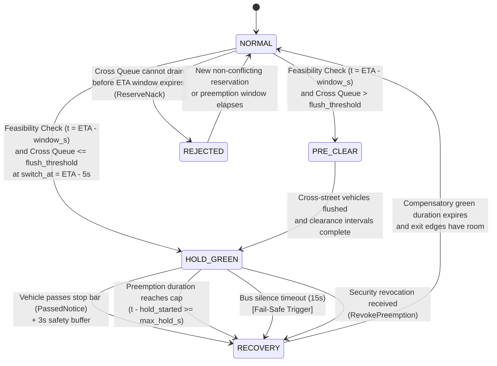
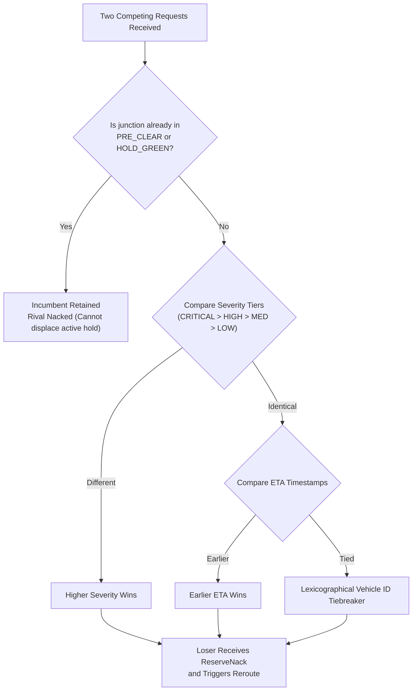

# ClearPath-lite Junction Protocol & State Machine

The `JunctionAgent` protocol orchestrates distributed signal preemption across urban intersections, balancing rapid corridor clearing for emergency vehicles with equitable phase recovery and provable conflict safety.

## Table of Contents
- [1. Junction State Machine Lifecycle](#1-junction-state-machine-lifecycle)
- [2. Detailed State Descriptions & Transitions](#2-detailed-state-descriptions--transitions)
  - [2.1 NORMAL State & Fixed-Time Cycling](#21-normal-state--fixed-time-cycling)
  - [2.2 Feasibility Check & PRE_CLEAR Phase](#22-feasibility-check--pre_clear-phase)
  - [2.3 HOLD_GREEN Phase & Green Wave Locking](#23-hold_green-phase--green-wave-locking)
  - [2.4 Compensatory RECOVERY Phase](#24-compensatory-recovery-phase)
  - [2.5 REJECTED State & Rollback](#25-rejected-state--rollback)
  - [2.6 Fail-Safe Timeout State](#26-fail-safe-timeout-state)
- [3. Concurrency & Overlapping-Reservation Priority](#3-concurrency--overlapping-reservation-priority)
- [4. Starvation Protection & Equitable Green Allocation](#4-starvation-protection--equitable-green-allocation)
- [5. Timing Parameters & Configuration Reference](#5-timing-parameters--configuration-reference)
- [6. Mathematical Proof of Conflict Prevention](#6-mathematical-proof-of-conflict-prevention)
- [7. Cross-Document References](#7-cross-document-references)

---

## 1. Junction State Machine Lifecycle

Each intersection is managed by an autonomous `JunctionAgent` operating according to the formal state transition diagram below:

---

## 2. Detailed State Descriptions & Transitions

### 2.1 NORMAL State & Fixed-Time Cycling
In the `NORMAL` state, the junction signal cycles autonomously under fixed-time control ([clearpath/sim/signals.py](file:///a:/CLEARPATH/clearpath/sim/signals.py)):
- Cycle Duration: `cycle_s = 60s`
- Green Duration: `green_s = 26s` per direction (North-South, then East-West)
- Clearance Intervals: Yellow (`yellow_s = 3s`) and All-Red (`all_red_s = 1s`) between every phase change.
- Staggered Offsets: Intersections use spatial offsets (`offset_s`) to minimize network-wide stop-and-go shockwaves.

### 2.2 Feasibility Check & PRE_CLEAR Phase
When an `EtaNotice` is received, the junction schedules a local feasibility evaluation at $t_{\text{plan}} = \text{ETA} - \text{window\_s}$ (where `window_s = 25s`):
1. The agent inspects the cross-street approach queue length $Q_{\text{cross}}$ from `WorldView`.
2. **Short Queue Case ($Q_{\text{cross}} \le \text{queue\_flush\_threshold} = 12\text{ veh}$):**
   The junction determines that normal traffic flow will not impede preemption. It schedules green switchover for $\text{ETA} - 5.0\text{ s}$ (`_HOLD_LEAD_S`).
3. **Long Queue Case ($Q_{\text{cross}} > 12\text{ veh}$):**
   A large queue stranded in front of a red light risks spillback that could block the intersection. The agent calculates required clearing time:
   $$t_{\text{clear}} = \frac{Q_{\text{cross}} \cdot (L_{\text{veh}} + d_{\text{gap}})}{v_{\text{cross\_limit}}}$$
   The usable time before preemption must engage is:
   $$t_{\text{usable}} = (\text{ETA} - t_{\text{now}}) - t_{\text{transition}}$$
   Where $t_{\text{transition}} = \text{yellow\_s} + \text{all\_red\_s} = 4.0\text{ s}$.
   - If $t_{\text{clear}} \le t_{\text{usable}}$: The junction immediately enters `PRE_CLEAR`, shortening the cross-street green to flush queued vehicles before switching.
   - If $t_{\text{clear}} > t_{\text{usable}}$: The queue cannot drain in time. The junction rejects the reservation, issues a `ReserveNack`, and enters `REJECTED`.

### 2.3 HOLD_GREEN Phase & Green Wave Locking
Upon entering `HOLD_GREEN`, the agent engages an actuator override for the emergency vehicle's approach phase:
- **Minimum Green Enforcement:** The switchover will not cut a cross-traffic green before it has run for at least `min_green_for_cross_s` ($8.0\text{ s}$), unless an immediate emergency override is justified by proximity ($\text{ETA} - t_{\text{now}} < 10.0\text{ s}$).
- **Arrival Maintenance:** Live telemetry updates refine the ETA tick-by-tick. Every tick, the junction broadcasts `GreenWavePrepare` to its downstream neighbor, updating expected arrival estimates.
- **Passed Buffer:** When the vehicle clears the stop bar (triggering `PassedNotice`), green is held for an additional $3.0\text{ s}$ buffer (`_HOLD_AFTER_PASS_S`) to clear trailing emergency units before release.

### 2.4 Compensatory RECOVERY Phase
Traditional preemption abandons the intersection immediately after emergency passage, stranding starved cross traffic. ClearPath enforces a mandatory `RECOVERY` phase:
1. Override transfers immediately to the **starved orthogonal phase** (e.g., if preemption served North-South, recovery serves East-West).
2. The physical actuator enforces standard yellow and all-red clearance intervals before cross green illuminates.
3. The cross green is held for a compensatory duration:
   $$t_{\text{recovery}} = \text{recovery\_s} + \min(\text{delay\_suffered}, \, \text{recovery\_s})$$
   Where `recovery_s = 20s`, providing up to $40.0\text{ s}$ of dedicated green to dissolve cross queues.
4. The controller checks `_cross_exits_have_room()` before releasing to ensure downstream exits have absorbed the flow.

### 2.5 REJECTED State & Rollback
If an approach cannot accommodate preemption, the junction enters `REJECTED` and returns `ReserveNack` specifying the earliest feasible arrival time. The Nack triggers an automated upstream rollback across all prior junctions, prompting the `DispatcherAgent` to compute an alternative route.

### 2.6 Fail-Safe Timeout State
If wireless communications drop while a junction is holding green for an ambulance:
- The agent tracks the timestamp of the last valid bus message (`_last_message_t`).
- If $(t_{\text{now}} - t_{\text{last}}) > \text{bus\_silence\_timeout\_ticks}$ ($15.0\text{ s}$), the fail-safe triggers.
- The junction aborts the preemption hold, issues a `RecoveryStarted` notice, and immediately enters `RECOVERY` to prevent deadlocks.

---

## 3. Concurrency & Overlapping-Reservation Priority

When multiple emergency vehicles approach the same junction within the lookahead window ($|\text{ETA}_1 - \text{ETA}_2| < \text{window\_s}$), the agent applies deterministic conflict resolution:

---

## 4. Starvation Protection & Equitable Green Allocation

ClearPath enforces three mathematical constraints preventing cross-street gridlock:

1. **Preemption Hold Cap (`max_preemption_hold_s = 45s`):**
   Even under severe ambulance crawl speeds, no preemption override can hold a green signal for more than $45.0\text{ s}$. If this cap is reached, preemption is forcefully terminated, and recovery engages.
2. **Proportional Recovery Scaling:**
   Cross streets starved of green time receive compensatory green time scaled $1:1$ with the duration of the preemption hold, up to an additional `recovery_s` ($20\text{ s}$).
3. **Queue Drainage Verification:**
   Recovery does not release until queued cross-traffic dissipates, capped by `_recovery_deadline` ($t_{\text{recovery}} + 20\text{ s}$).

---

## 5. Timing Parameters & Configuration Reference

All timing parameters are declared in [clearpath/config.py](file:///a:/CLEARPATH/clearpath/config.py):

| Parameter | Default Value | Unit | Functional Role |
|---|:---:|:---:|---|
| `cycle_s` | 60 | s | Full signal cycle time. |
| `green_s` | 26 | s | Normal phase green time. |
| `yellow_s` | 3 | s | Mandatory yellow clearance transition. |
| `all_red_s` | 1 | s | Mandatory all-red intersection clearance interval. |
| `window_s` | 25 | s | Preemption planning and reservation lookahead. |
| `min_green_for_cross_s` | 8 | s | Minimum green guaranteed to cross street before preemption override. |
| `queue_flush_threshold` | 12 | veh | Queue count triggering proactive `PRE_CLEAR` drainage. |
| `recovery_s` | 20 | s | Base post-preemption recovery phase duration. |
| `max_preemption_hold_s` | 45 | s | Hard ceiling capping preemption hold duration. |
| `negotiation_timeout_ticks` | 5 | ticks | Ticks to wait for downstream `ReserveAck` before treating as Nack. |
| `bus_silence_timeout_ticks` | 15 | ticks | Bus silence ticks before fail-safe releases green hold into recovery. |

---

## 6. Mathematical Proof of Conflict Prevention

### Theorem (Zero Conflicting Greens Invariant):
*At no simulation tick $t$ can two conflicting orthogonal approaches (North-South and East-West) display green simultaneously at any junction $j$.*

### Proof:
1. **Actuator Abstraction Boundary:** Agents do not set hardware signal lamps directly. They invoke `actuators.set_signal_override(node_id, target_phase)`.
2. **Controller Transition Function:** In [clearpath/sim/signals.py](file:///a:/CLEARPATH/clearpath/sim/signals.py#L140-L185), the `SignalController` maintains an explicit state machine:
   $$\Phi \in \{\text{NS\_GREEN}, \text{NS\_YELLOW}, \text{ALL\_RED\_TO\_EW}, \text{EW\_GREEN}, \text{EW\_YELLOW}, \text{ALL\_RED\_TO\_NS}\}$$
3. **State Mutex:** Each phase $\phi \in \Phi$ is mutually exclusive. By definition of the Enum, the controller exists in exactly one state at any tick $t$.
4. **Enforced Clearance Interval:** To transition from $\text{NS\_GREEN}$ to $\text{EW\_GREEN}$, the controller requires:
   $$\text{NS\_GREEN} \xrightarrow{\ge \text{yellow\_s}} \text{NS\_YELLOW} \xrightarrow{\ge \text{all\_red\_s}} \text{ALL\_RED\_TO\_EW} \to \text{EW\_GREEN}$$
   The minimum transition duration is $\text{yellow\_s} + \text{all\_red\_s} = 3.0\text{ s} + 1.0\text{ s} = 4.0\text{ s}$.
5. During this 4-second clearance window, neither approach displays green.
6. Therefore, conflicting orthogonal greens cannot occur simultaneously under any agent command sequence. $\blacksquare$

*Verified empirically across 600 ticks of randomized emergency scenarios in `test_sim.py::test_signals_never_conflicting_greens` and `test_engine.py::test_no_conflicting_greens_600_ticks`.*

---

## 7. Cross-Document References
- For message formats and handshakes, see [MESSAGE_PROTOCOL.md](MESSAGE_PROTOCOL.md).
- For hospital selection and corridor ETA scheduling, see [DISPATCHER_ALGORITHM.md](DISPATCHER_ALGORITHM.md).
- For empirical throughput recovery benchmarks, see [RESULTS.md](RESULTS.md).

