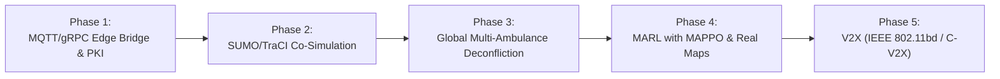

# ClearPath-lite Limitations & Future Roadmap

This document provides a transparent evaluation of the physical, network, and algorithmic limitations of ClearPath-lite, followed by a prioritized engineering roadmap for production deployment.

## Table of Contents
- [1. Transparent System Limitations](#1-transparent-system-limitations)
  - [1.1 Simulation Realism & 1D Kinematics](#11-simulation-realism--1d-kinematics)
  - [1.2 In-Process Communication vs. Physical Radio](#12-in-process-communication-vs-physical-radio)
  - [1.3 Static Hospital Database](#13-static-hospital-database)
  - [1.4 Single-Corridor Ambulance Focus](#14-single-corridor-ambulance-focus)
  - [1.5 Symmetric Cryptography Constraints](#15-symmetric-cryptography-constraints)
- [2. Prioritized Engineering Roadmap](#2-prioritized-engineering-roadmap)
  - [Phase 1: Secure Edge Telemetry & Protocol Bridges (Near-Term)](#phase-1-secure-edge-telemetry--protocol-bridges-near-term)
  - [Phase 2: High-Fidelity Simulation Adapters (SUMO / TraCI)](#phase-2-high-fidelity-simulation-adapters-sumo--traci)
  - [Phase 3: Multi-Ambulance Deconfliction & Fleet Management](#phase-3-multi-ambulance-deconfliction--fleet-management)
  - [Phase 4: Multi-Agent RL with MAPPO & Continuous Optimization](#phase-4-multi-agent-rl-with-mappo--continuous-optimization)
  - [Phase 5: Real-World Connected Vehicle (V2X) Integration](#phase-5-real-world-connected-vehicle-v2x-integration)
- [3. Cross-Document References](#3-cross-document-references)

---

## 1. Transparent System Limitations

### 1.1 Simulation Realism & 1D Kinematics
- **1D Coordinate Modeling:** Vehicles advance along 1D longitudinal offsets along directed edges. Lateral overtaking, lane-change drift trajectories, and continuous vehicle yaw angles are simplified into discrete lane indices (`lane=0`, `lane=1`).
- **Intersection Internal Box Physics:** When crossing an intersection, vehicles transition directly between the inbound edge and outbound edge without modeling lateral turning curves or conflicting turn paths within the intersection interior box. Safety relies on signal clearance intervals.
- **Homogeneous Vehicle Profiles:** Civilian vehicles share uniform vehicle lengths ($7.5\text{ m}$) and braking profiles. Heavy freight trucks, articulated city buses, motorcycles, and vulnerable road users (pedestrians and cyclists) are not represented.

### 1.2 In-Process Communication vs. Physical Radio
- **Shared Memory Space:** The `MessageBus` executes inside the Python process memory space. While it simulates packet transit latency and stochastic drops, it does not encounter real-world physical-layer issues such as multipath fading, Doppler frequency shift, or RF signal attenuation caused by tall urban buildings.
- **No TLS Transport:** Communication between agents does not wrap messages in TLS/DTLS packets; authentication is enforced solely at the application layer via HMAC tokens.

### 1.3 Static Hospital Database
- In the current implementation, hospital bed capacities and ER waiting times are loaded from initial configuration dictionaries. In real municipal deployments, hospital telemetry fluctuates dynamically based on electronic health record (EHR) admissions and ambulance offload delays.

### 1.4 Single-Corridor Ambulance Focus
- While ClearPath tests dual simultaneous ambulances with priority resolution (`test_scenarios.py::test_two_simultaneous_ambulances_priority_no_conflict`), the primary preemption algorithms are optimized for single-corridor emergency corridors. Complex multi-corridor preemption with overlapping intersections requires global joint optimization.

### 1.5 Symmetric Cryptography Constraints
- Preemption tokens use HMAC-SHA256 with a pre-shared key. If a physical ambulance unit is compromised and its key extracted from vehicle memory, an adversary could forge tokens until the gateway revokes the key. A full Public Key Infrastructure (PKI) with asymmetric signatures (ECDSA / Ed25519) is required for production fleets.

---

## 2. Prioritized Engineering Roadmap

### Phase 1: Secure Edge Telemetry & Protocol Bridges (Near-Term)
- **MQTT / gRPC Bridge:** Implement network adapters for the `MessageBus` allowing agents to run on distributed hardware controllers (e.g., Raspberry Pi or NVIDIA Jetson edge units) communicating over encrypted MQTT (TLS 1.3) or gRPC.
- **Asymmetric PKI Credentials:** Upgrade token authentication to support ECDSA (secp256r1) and Ed25519 digital signatures. Incorporate per-vehicle X.509 certificates and an Online Certificate Status Protocol (OCSP) revocation cache.
- **Dynamic Hospital Telemetry (FHIR/HL7):** Connect the `DispatcherAgent` to simulated HL7 FHIR hospital emergency department feeds for live bed tracking.

### Phase 2: High-Fidelity Simulation Adapters (SUMO / TraCI)
- **SUMO Co-Simulation Bridge:** Author a TraCI adapter module ([clearpath/sim/adapters/sumo.py](file:///a:/CLEARPATH/clearpath/sim/adapters/sumo.py)) that translates ClearPath agent commands into native SUMO signal overrides (`traci.trafficlight.setPhase`) and vehicle trajectories.
- **Real-World Map Ingestion:** Ingest real municipal road networks from OpenStreetMap using OSMnx, translating real GPS coordinates and road widths into ClearPath topologies.

### Phase 3: Multi-Ambulance Deconfliction & Fleet Management
- **Joint Spatio-Temporal Corridor Deconfliction:** Extend the `DispatcherAgent` to coordinate multiple simultaneous emergency vehicles traversing crossing corridors, dynamically timing signal holds to allow both vehicles to clear without either coming to a full stop.
- **Dynamic Speed Advisory (GLOSA):** Transmit Green Light Optimized Speed Advisory (GLOSA) targets to ambulances, instructing drivers to adjust cruise speeds to arrive exactly as signals turn green.

### Phase 4: Multi-Agent RL with MAPPO & Continuous Optimization
- **Multi-Agent PPO (MAPPO):** Transition the RL controller from independent Q-learning to Multi-Agent Proximal Policy Optimization (MAPPO) with centralized value functions and decentralized execution.
- **Continuous Actuation:** Enable the policy to dynamically modulate green splits in real time rather than selecting from discrete phase steps.

### Phase 5: Real-World Connected Vehicle (V2X) Integration
- **C-V2X & DSRC Standards:** Align message payloads with international Intelligent Transportation Systems (ITS) standards, including SAE J2735 Emergency Vehicle Alert (EVA) and Signal Request Message (SRM) formats.
- **Hardware-in-the-Loop (HIL) Testing:** Interface ClearPath controllers with commercial traffic signal controller cabinets (e.g., NEMA TS2, 2070, or ATC controllers).

---

## 3. Cross-Document References
- For existing architectural decisions and trade-offs, see [DESIGN_DECISIONS.md](DESIGN_DECISIONS.md).
- For cryptographic token specifications, see [SECURITY.md](SECURITY.md).
- For current simulation physics and limitations, see [SIMULATION.md](SIMULATION.md).

