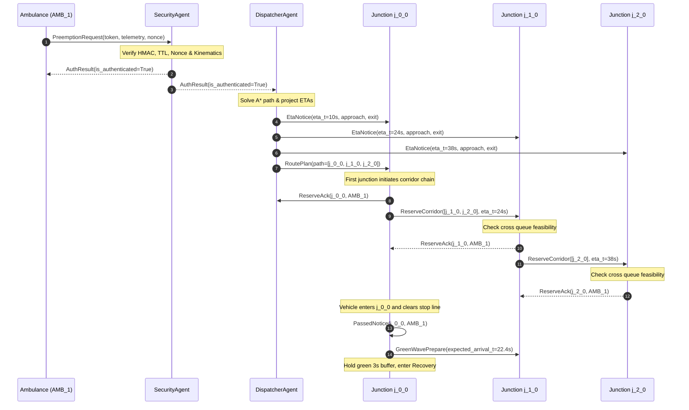
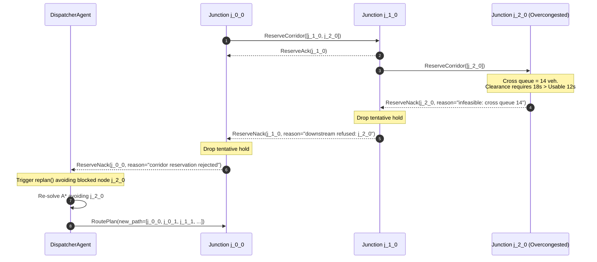
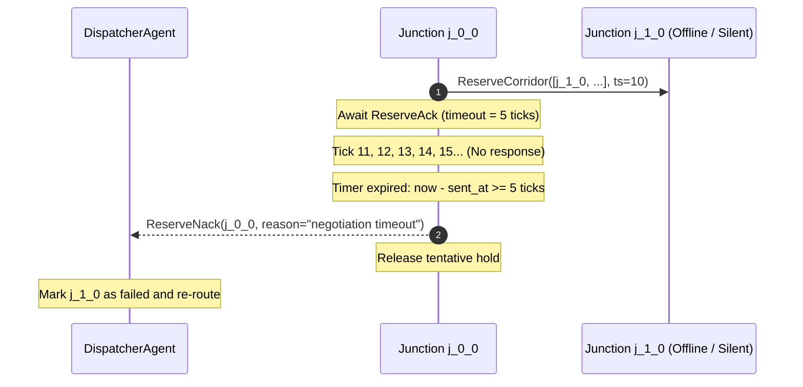
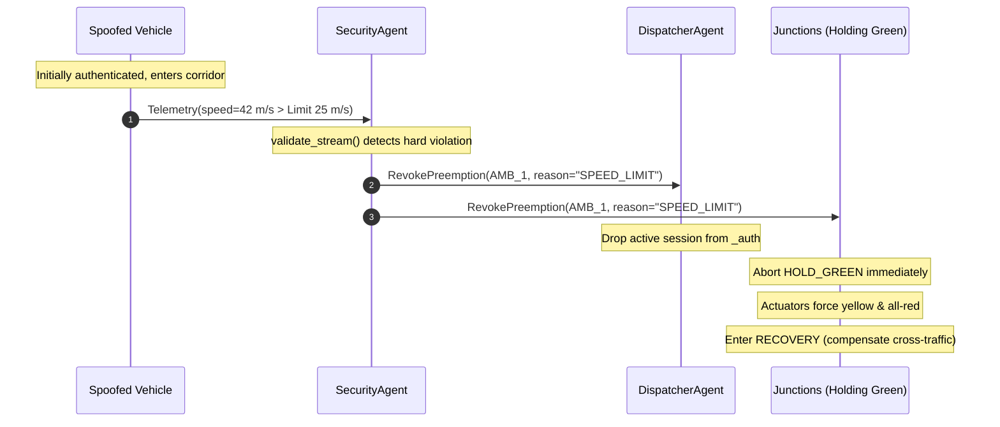

# ClearPath-lite Message Protocol Specification

This document defines the communication protocol, message schemas, and distributed negotiation handshakes utilized across ClearPath-lite's event-driven multi-agent architecture.

## Table of Contents
- [1. Communication Bus Architecture](#1-communication-bus-architecture)
  - [1.1 Delivery Semantics & Addressing](#11-delivery-semantics--addressing)
  - [1.2 Simulated Network Latency & Message Drops](#12-simulated-network-latency--message-drops)
- [2. Message Schema Catalog](#2-message-schema-catalog)
  - [2.1 Base Message & Telemetry](#21-base-message--telemetry)
  - [2.2 Security & Dispatch Messages](#22-security--dispatch-messages)
  - [2.3 Corridor Reservation & Coordination Messages](#23-corridor-reservation--coordination-messages)
  - [2.4 Guidance & Advisory Messages](#24-guidance--advisory-messages)
- [3. Corridor Negotiation Handshakes](#3-corridor-negotiation-handshakes)
  - [3.1 Success Case: Seamless Sequential Reservation](#31-success-case-seamless-sequential-reservation)
  - [3.2 Rollback Case: Downstream Rejection (Nack)](#32-rollback-case-downstream-rejection-nack)
  - [3.3 Timeout Case: Silent Downstream Agent](#33-timeout-case-silent-downstream-agent)
  - [3.4 Revocation Case: Mid-Route Kinematic Violation](#34-revocation-case-mid-route-kinematic-violation)
- [4. Cross-Document References](#4-cross-document-references)

---

## 1. Communication Bus Architecture

### 1.1 Delivery Semantics & Addressing
The `MessageBus` ([clearpath/bus/message_bus.py](file:///a:/CLEARPATH/clearpath/bus/message_bus.py)) provides an in-process, asynchronous communication backbone decoupling agent lifecycles:
- **Addressing:** Messages specify a `recipient` string. An agent ID (e.g., `"j_0_1"`) designates unicast delivery; the wildcard `"*"` designates broadcast delivery to all active agents and junctions.
- **Delivery Invariant:** Messages are queued in-flight and delivered during the orchestrator's `bus.deliver(t)` call at the beginning of each discrete tick.

### 1.2 Simulated Network Latency & Message Drops
To model real-world wireless vehicle-to-infrastructure (V2I) channel impairments, the message bus supports deterministic latency and packet loss models:
- **Latency Distribution:** Messages are delayed by $d$ ticks, where $d \sim \text{Poisson}(\lambda)$ or uniform bounds. A message sent at tick $t$ is not delivered until $t + d$.
- **Packet Loss Simulation:** Each transmission is subjected to an independent Bernoulli trial with drop probability $p_{\text{drop}}$ (tested under $10\%$ drop rates in `test_message_drop_ten_percent_graceful_degradation`). Dropped messages are discarded without raising exceptions, testing agent fail-safe behaviors.

---

## 2. Message Schema Catalog

All message definitions derive from the base dataclass `Message` in [clearpath/bus/messages.py](file:///a:/CLEARPATH/clearpath/bus/messages.py).

### 2.1 Base Message & Telemetry

#### `Message` (Base Dataclass)
Base structure inherited by all typed protocol messages.
| Field | Type | Description |
|---|---|---|
| `id` | `str` | UUID4 string uniquely identifying the message instance. |
| `ts` | `float` | Simulation timestamp (seconds) when dispatched. |
| `sender` | `str` | Identifier of originating entity (e.g., `"AMB_1"`, `"dispatcher"`). |
| `recipient` | `str` | Target entity identifier or `"*"` for broadcast. |
| `type` | `str` | Class discriminator name, automatically set in `__post_init__`. |

#### `Telemetry`
Transmitted by emergency vehicles to report live kinematic motion.
| Field | Type | Description |
|---|---|---|
| `vehicle_id` | `str` | Reporting vehicle identifier. |
| `x` | `float` | Cartesian X coordinate in meters. |
| `y` | `float` | Cartesian Y coordinate in meters. |
| `speed_mps` | `float` | Instantaneous velocity in m/s. |
| `accel_mps2` | `float` | Instantaneous acceleration in $\text{m/s}^2$. |
| `heading_deg` | `float` | Heading angle in degrees $[0, 360)$. |
| `edge_id` | `str` | Directed road segment ID currently occupied (e.g., `"j_0_0_j_0_1"`). |
| `lane` | `int` | Occupied lane index (0 = shoulder, 1 = inner). |

---

### 2.2 Security & Dispatch Messages

#### `PreemptionRequest`
Submitted by emergency vehicles to request green-wave preemption.
| Field | Type | Description |
|---|---|---|
| `vehicle_id` | `str` | Emergency vehicle identifier. |
| `token` | `str` | HMAC-SHA256 token string (`vehicle_id.nonce.ts.signature`). |
| `nonce` | `str` | Cryptographic single-use nonce. |
| `incident_loc` | `Tuple[float, float]` | Origin coordinates $(x, y)$ of the emergency incident. |
| `severity` | `str` | Triage priority (`"CRITICAL"`, `"HIGH"`, `"MEDIUM"`, `"LOW"`). |
| `telemetry` | `Telemetry` | Kinematic telemetry snapshot captured at dispatch. |

#### `AuthResult`
Emitted by `SecurityAgent` in response to a `PreemptionRequest`.
| Field | Type | Description |
|---|---|---|
| `vehicle_id` | `str` | Vehicle evaluated. |
| `is_authenticated` | `bool` | True if cryptographic and kinematic checks passed. |
| `reasons` | `List[str]` | Failure reason codes (e.g., `["TOKEN"]`, `["SPEED_LIMIT"]`). |
| `security_log` | `str` | Human-readable audit log summary string. |
| `risk_score` | `float` | Weighted soft risk metric $[0.0, 1.0]$. |

#### `RevokePreemption`
Broadcast by `SecurityAgent` when an active vehicle violates kinematics mid-route.
| Field | Type | Description |
|---|---|---|
| `vehicle_id` | `str` | Vehicle whose preemption authorization is withdrawn. |
| `reason` | `str` | Triggering reason codes (e.g., `"CONTINUITY"`, `"SPEED_LIMIT"`). |

#### `RoutePlan`
Broadcast by `DispatcherAgent` upon successful hospital selection and route solving.
| Field | Type | Description |
|---|---|---|
| `vehicle_id` | `str` | Emergency vehicle assigned to the route. |
| `hospital_id` | `str` | Target medical facility ID. |
| `path_nodes` | `List[str]` | Ordered sequence of network junctions to traverse. |
| `eta_by_junction` | `Dict[str, float]` | Relative travel seconds from origin to each junction. |
| `total_eta_s` | `float` | Expected total travel duration to the destination. |

#### `EtaNotice`
Unicast by `DispatcherAgent` to individual junctions along the planned corridor.
| Field | Type | Description |
|---|---|---|
| `junction_id` | `str` | Target junction node. |
| `vehicle_id` | `str` | Approaching vehicle ID. |
| `eta_t` | `float` | Absolute simulation timestamp of scheduled arrival. |
| `approach_edge` | `str` | Inbound road edge entering the junction. |
| `exit_edge` | `str` | Outbound road edge departing the junction. |

---

### 2.3 Corridor Reservation & Coordination Messages

#### `ReserveCorridor`
Sent from upstream junctions to downstream neighbors to negotiate sequential locks.
| Field | Type | Description |
|---|---|---|
| `vehicle_id` | `str` | Emergency vehicle requesting passage. |
| `corridor_nodes` | `List[str]` | Remaining downstream sequence of junction nodes. |
| `eta_t` | `float` | Target arrival time at the downstream recipient. |
| `duration_s` | `float` | Requested reservation green window duration (default 25.0s). |

#### `ReserveAck`
Returned by a junction confirming approach reservation.
| Field | Type | Description |
|---|---|---|
| `junction_id` | `str` | Confirming junction ID. |
| `vehicle_id` | `str` | Vehicle granted reservation. |
| `reservation_id` | `str` | Unique tracking ID for the active reservation lock. |

#### `ReserveNack`
Returned when a junction cannot accommodate preemption (e.g., undrainable cross queues).
| Field | Type | Description |
|---|---|---|
| `junction_id` | `str` | Rejecting junction ID. |
| `vehicle_id` | `str` | Rejected vehicle ID. |
| `reason` | `str` | Detailed rationale and earliest feasible arrival time. |

#### `GreenWavePrepare`
Continuous neighbor-to-neighbor handoff updating live arrival forecasts.
| Field | Type | Description |
|---|---|---|
| `from_junction_id` | `str` | Upstream junction clearing the vehicle. |
| `to_junction_id` | `str` | Downstream junction preparing green wave. |
| `vehicle_id` | `str` | Emergency vehicle in transit. |
| `expected_arrival_t` | `float` | Refined arrival timestamp based on live velocity. |

#### `PassedNotice`
Emitted when an emergency vehicle clears an intersection stop bar.
| Field | Type | Description |
|---|---|---|
| `junction_id` | `str` | Cleared intersection ID. |
| `vehicle_id` | `str` | Emergency vehicle ID. |
| `t` | `float` | Timestamp when vehicle passed the stop line. |

#### `RecoveryStarted` / `RecoveryDone`
Broadcast notices announcing commencement and completion of cross-street recovery.
| Message | Key Fields | Description |
|---|---|---|
| `RecoveryStarted` | `junction_id: str`, `recovery_duration_s: float` | Emitted when compensatory cross-street green begins. |
| `RecoveryDone` | `junction_id: str` | Emitted when normal signal cycle resumes. |

---

### 2.4 Guidance & Advisory Messages

#### `GuidanceAdvisory`
Published by `GuidanceAgent` to provide tactical lane-clearing directives to drivers.
| Field | Type | Description |
|---|---|---|
| `target_vehicle_ids` | `List[str]` | IDs of recipient civilian vehicles. |
| `text` | `str` | Driver instruction string (e.g., `"Clear lane 0"`, `"Slow down"`). |
| `lane` | `int` | Recommended target lane index. |
| `severity` | `str` | Urgency tier (`"INFO"`, `"WARN"`, `"CRITICAL"`). |

---

## 3. Corridor Negotiation Handshakes

### 3.1 Success Case: Seamless Sequential Reservation

---

### 3.2 Rollback Case: Downstream Rejection (Nack)

When a downstream junction cannot drain its cross-street queue before the announced ETA, it rejects the reservation. The refusal cascades upstream, releasing tentative locks:

---

### 3.3 Timeout Case: Silent Downstream Agent

If a downstream agent crashes or network packets are dropped, the upstream coordinator enforces `negotiation_timeout_ticks`:

---

### 3.4 Revocation Case: Mid-Route Kinematic Violation

---

## 4. Cross-Document References
- For cryptographic and kinematic rule details, see [SECURITY.md](SECURITY.md).
- For junction state machine transitions during handshakes, see [JUNCTION_PROTOCOL.md](JUNCTION_PROTOCOL.md).
- For hospital selection and ETA calculation formulas, see [DISPATCHER_ALGORITHM.md](DISPATCHER_ALGORITHM.md).

