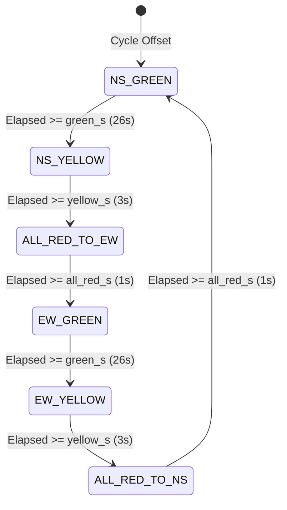

# ClearPath-lite Microscopic Traffic Simulation

ClearPath-lite features a dedicated microscopic traffic simulator implemented in pure Python, providing deterministic kinematics, car-following physics, and fixed-time signal cycles for fast prototyping and reinforcement learning.

## Table of Contents
- [1. Road Network & Topology](#1-road-network--topology)
  - [1.1 Grid Geometry & Coordinate System](#11-grid-geometry--coordinate-system)
  - [1.2 Edge Attributes & Road Hierarchy](#12-edge-attributes--road-hierarchy)
- [2. Microscopic Vehicle Kinematics (IDM-lite)](#2-microscopic-vehicle-kinematics-idm-lite)
  - [2.1 Mathematical Model & Acceleration Equation](#21-mathematical-model--acceleration-equation)
  - [2.2 Leader Vehicle Detection & Red-Light Stop Lines](#22-leader-vehicle-detection--red-light-stop-lines)
  - [2.3 Kinematic Parameters](#23-kinematic-parameters)
- [3. Multi-Lane Representation & Yielding Physics](#3-multi-lane-representation--yielding-physics)
- [4. Traffic Signal Controllers & Clearance Intervals](#4-traffic-signal-controllers--clearance-intervals)
- [5. Synthetic Traffic Generation (Poisson Arrivals)](#5-synthetic-traffic-generation-poisson-arrivals)
- [6. Determinism & Seeding Architecture](#6-determinism--seeding-architecture)
- [7. Known Physical Limitations](#7-known-physical-limitations)
- [8. Cross-Document References](#8-cross-document-references)

---

## 1. Road Network & Topology

### 1.1 Grid Geometry & Coordinate System
The urban environment is modeled as a 2D directed graph $G=(V, E)$ implemented via NetworkX in [clearpath/sim/network.py](file:///a:/CLEARPATH/clearpath/sim/network.py):
- **Junction Nodes ($V$):** Arranged in a rectangular grid of rows and columns (default $6 \times 6 = 36$ intersections). Node identifiers follow the Cartesian naming pattern `j_row_col` (e.g., `j_0_0` at the origin to `j_5_5`).
- **Intersection Spacing:** Nodes are separated by `block_length_m = 200.0m`.
- **Cartesian Coordinates:**
  $$x = \text{col} \cdot \text{block\_length\_m}, \quad y = \text{row} \cdot \text{block\_length\_m}$$
  For a $6 \times 6$ grid, the physical space spans $[0.0, 1000.0\text{ m}] \times [0.0, 1000.0\text{ m}]$ ($1.0\text{ km}^2$).

### 1.2 Edge Attributes & Road Hierarchy
Adjacent intersections are connected by bidirectional directed edges. Roads are classified into a two-tier hierarchy:
- **Arterial Roads (Even rows/cols):**
  - Speed limit: $v_{\text{arterial}} = 16.7\text{ m/s}$ ($\approx 60\text{ km/h}$).
  - Lane count: 2 lanes per direction.
  - Priority corridors for emergency vehicle transit.
- **Residential Streets (Odd rows/cols):**
  - Speed limit: $v_{\text{residential}} = 11.1\text{ m/s}$ ($\approx 40\text{ km/h}$).
  - Lane count: 1 lane per direction.
- **Edge Data Fields:** Each graph edge stores `length_m` ($200.0\text{ m}$), `speed_limit_mps`, `lanes`, `bearing_deg` ($0^\circ, 90^\circ, 180^\circ, 270^\circ$), and `free_flow_time_s` ($\frac{L}{v_{\text{limit}}}$).

---

## 2. Microscopic Vehicle Kinematics (IDM-lite)

Vehicle motion is governed by a modified Intelligent Driver Model (IDM-lite) implemented in [clearpath/sim/vehicles.py](file:///a:/CLEARPATH/clearpath/sim/vehicles.py).

### 2.1 Mathematical Model & Acceleration Equation
At each discrete tick ($\Delta t = 1.0\text{ s}$), vehicle acceleration $a$ is computed as:

$$a = a_{\max} \cdot \left[1 - \left(\frac{v}{v_0}\right)^4 - \left(\frac{s^*(v, \Delta v)}{s}\right)^2\right]$$

Where:
- $v$: Instantaneous vehicle velocity in m/s.
- $v_0$: Desired velocity (posted edge speed limit $v_{\text{limit}}$, or emergency top speed $v_{\text{amb\_max}}$).
- $s$: Net longitudinal bumper-to-bumper distance to the lead constraint in meters.
- $\Delta v = v - v_{\text{lead}}$: Approach rate / velocity difference to the leader.
- $s^*$: Desired dynamic safety distance:
  $$s^*(v, \Delta v) = s_0 + \max\left(0, \, v \cdot T + \frac{v \cdot \Delta v}{2 \sqrt{a_{\max} \cdot b}}\right)$$
  - $s_0 = 2.5\text{ m}$: Minimum jam clearance distance.
  - $T = 1.2\text{ s}$: Desired time headway.
  - $a_{\max} = 2.5\text{ m/s}^2$ ($4.0\text{ m/s}^2$ for ambulances): Maximum acceleration.
  - $b = 3.0\text{ m/s}^2$: Comfortable braking deceleration.

Acceleration is strictly clamped within physical bounds:
$$-6.0\text{ m/s}^2 \le a \le a_{\max}$$

### 2.2 Leader Vehicle Detection & Red-Light Stop Lines
The net distance $s$ is the minimum of two physical constraints:
1. **Physical Vehicle Leader:** The nearest vehicle occupying the same lane ahead on the edge:
   $$s_{\text{veh}} = \text{offset}_{\text{lead}} - \text{offset}_{\text{self}} - L_{\text{lead}}$$
2. **Signal Stop Line:** If the approaching intersection signal is `YELLOW` or `RED`, the stop bar at the edge end ($L_{\text{edge}} = 200.0\text{ m}$) acts as a stationary leader ($v_{\text{lead}} = 0$):
   $$s_{\text{signal}} = L_{\text{edge}} - \text{offset}_{\text{self}} - L_{\text{self}}$$

The vehicle decelerates smoothly to a stop before the stop bar without collision.

### 2.3 Kinematic Parameters

| Parameter | Civilian Car | Emergency Ambulance | Unit |
|---|:---:|:---:|:---:|
| Vehicle Length ($L_{\text{veh}}$) | 7.5 | 7.5 | m |
| Top Speed ($v_{\max}$) | 16.7 (Arterial) / 11.1 (Res) | 25.0 ($\approx 90\text{ km/h}$) | m/s |
| Max Acceleration ($a_{\max}$) | 2.5 | 4.0 | $\text{m/s}^2$ |
| Comfortable Deceleration ($b$) | 3.0 | 3.0 | $\text{m/s}^2$ |
| Hard Deceleration Floor | -6.0 | -6.0 | $\text{m/s}^2$ |
| Crawl Velocity ($v_{\text{crawl}}$) | — | 4.0 | m/s |

---

## 3. Multi-Lane Representation & Yielding Physics

- **Lane Indices:** On multi-lane edges (arterials), `lane=0` represents the left-most lane (shoulder in left-hand drive convention), and `lane=1` represents the inner/passing lane.
- **Yielding Behavior (`apply_yield`):**
  When civilian drivers receive advisories from the `GuidanceAgent`, the simulator applies yielding physics for `yield_until_t`:
  - Vehicles in `lane=1` attempt to merge into `lane=0` if spatial gaps permit.
  - Target speed $v_0$ is reduced to $50\%$ to let the ambulance pass.
  - On single-lane roads, vehicles decelerate and pull onto the road shoulder to create passage corridors.

---

## 4. Traffic Signal Controllers & Clearance Intervals

Each intersection operates an independent `SignalController` in [clearpath/sim/signals.py](file:///a:/CLEARPATH/clearpath/sim/signals.py):

- **Cycle Parameters:** Standard 60-second cycle ($26\text{s G} + 3\text{s Y} + 1\text{s R} + 26\text{s G} + 3\text{s Y} + 1\text{s R}$).
- **Preemption Safety State Machine:** If an agent requests an immediate green override, the controller intercepts the call. If the current phase is orthogonal, the controller initiates a forced clearance sequence (yellow $\ge 3\text{s}$, all-red $\ge 1\text{s}$) before switching to green. Orthogonal greens can never overlap.

---

## 5. Synthetic Traffic Generation (Poisson Arrivals)

Traffic demand is dynamically generated at boundary entry nodes by `TrafficGenerator` ([clearpath/sim/traffic_gen.py](file:///a:/CLEARPATH/clearpath/sim/traffic_gen.py)):
- **Perimeter Ingress:** Vehicles spawn at perimeter border nodes (`j_0_c`, `j_5_c`, `j_r_0`, `j_r_5`).
- **Poisson Arrival Rate:** Spawning follows an independent Poisson distribution per boundary intersection:
  $$P(k \text{ arrivals}) = \frac{\lambda^k e^{-\lambda}}{k!}$$
  - **`low` demand:** $\lambda = 0.04\text{ veh/tick/boundary}$
  - **`med` demand:** $\lambda = 0.10\text{ veh/tick/boundary}$
  - **`high` demand:** $\lambda = 0.20\text{ veh/tick/boundary}$
- **Route Assignment:** Vehicles pick random interior exit destinations. Travel paths are assigned via precomputed static Dijkstra shortest paths on `free_flow_time_s`.

---

## 6. Determinism & Seeding Architecture

ClearPath guarantees strict floating-point reproducibility:
- **Unified Generator:** Every stochastic choice (vehicle arrival intervals, origin-destination routing, initial speeds, sensor noise) is driven by `np.random.default_rng(config.seed)`.
- **Zero Global State:** Random generators are encapsulated within simulator class instances. Multiple simulation runs with identical seeds (`seed=42`) produce 100% bitwise-identical trajectories and metrics.
- **Verification Proof:** Tested in `test_sim.py::test_simulation_determinism` and `test_engine.py::test_determinism_same_seed_same_metrics`.

---

## 7. Known Physical Limitations

ClearPath-lite is designed for rapid multi-agent prototyping and evaluation. It intentionally abstracts complex microscopic details:
1. **1D Linear Lane Coordinates:** Vehicles follow 1D longitudinal coordinates along directed edges. Lateral lane-changing trajectories, vehicle yaw dynamics, and continuous steering angles are not simulated.
2. **Simplified Turning Conflicts:** In standard mode, vehicles crossing an intersection move directly to the outbound edge without diagonal path conflict checking inside the intersection box. Clearance safety relies entirely on signal phase clearance intervals.
3. **No Pedestrian or Cyclist Agents:** The simulator models motor vehicles only.
4. **Homogeneous Vehicle Profiles:** Civilian vehicles share uniform lengths ($7.5\text{ m}$) and acceleration profiles. Future extensions can incorporate buses, heavy trucks, and motorcycles.

For full microscopic fidelity including 3D meshes, lateral overtaking, and TraCI co-simulation, see the SUMO integration roadmap in [LIMITATIONS_AND_FUTURE_WORK.md](LIMITATIONS_AND_FUTURE_WORK.md).

---

## 8. Cross-Document References
- For agent coordination and preemption algorithms, see [AGENTS.md](AGENTS.md).
- For junction signal preemption state machines, see [JUNCTION_PROTOCOL.md](JUNCTION_PROTOCOL.md).
- For benchmark comparisons under low, med, and high demand, see [RESULTS.md](RESULTS.md).

